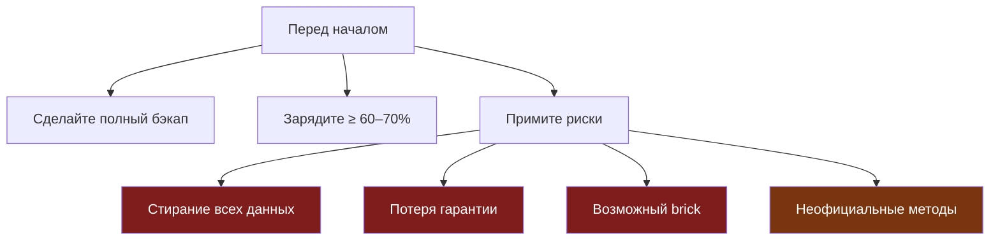
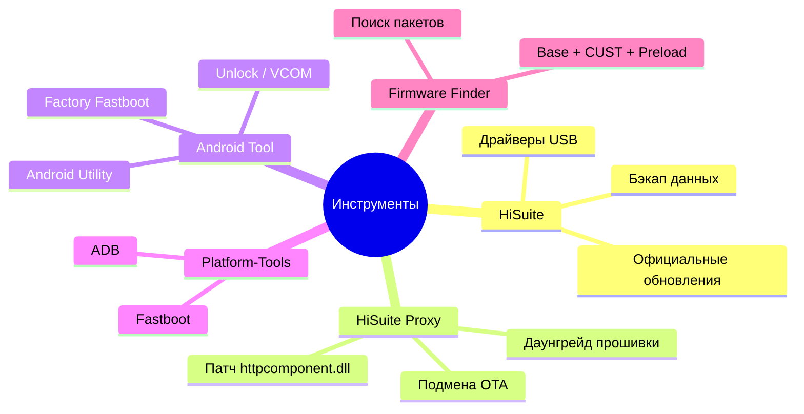
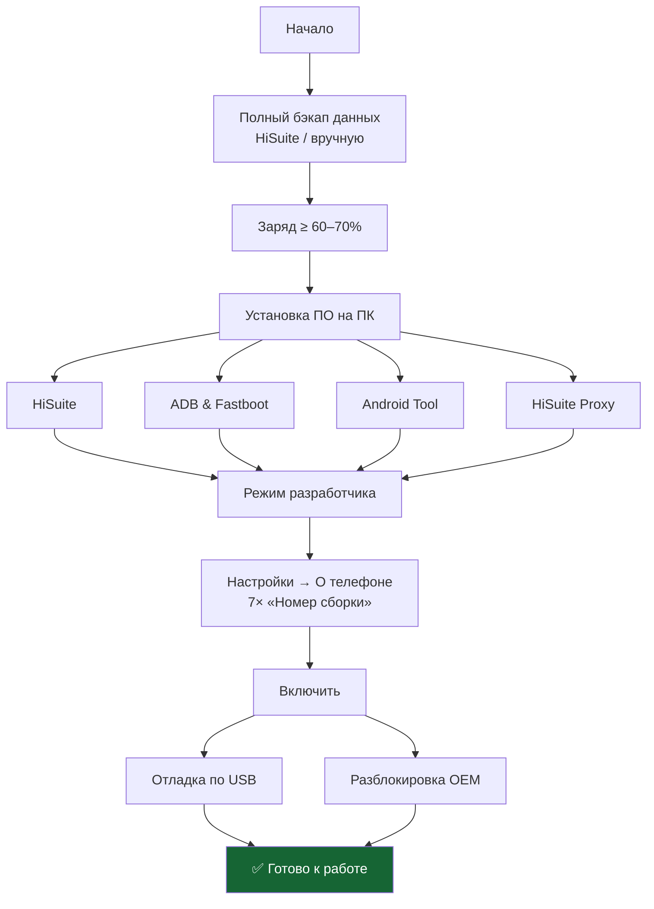
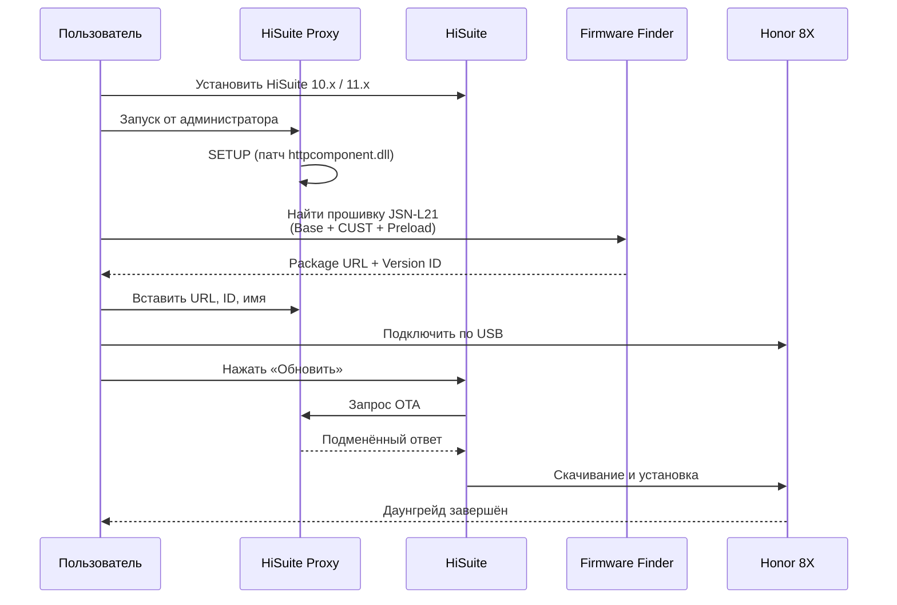
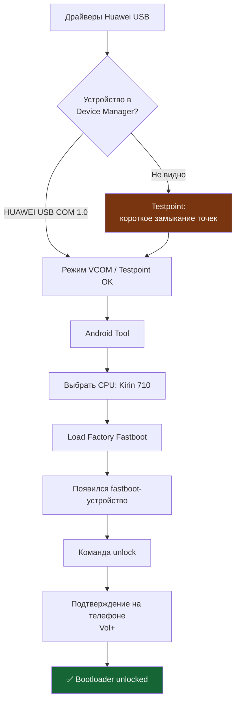
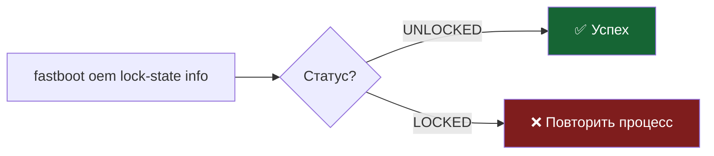
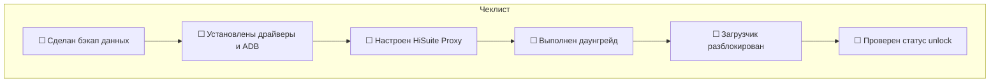
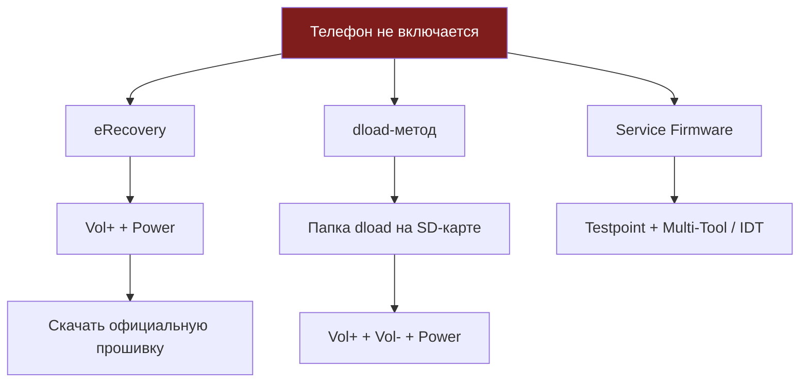

# 🔓 Разблокировка загрузчика Honor 8X (JSN-L21)

> Подробное руководство по unlock bootloader через **Android Tool** и **HiSuite Proxy**.  
> Позволяет установить кастомный recovery, root (Magisk) и альтернативные прошивки.

---

## 📱 Об устройстве

| Параметр | Значение |
|----------|----------|
| **Модель** | Honor 8X |
| **Коды** | JSN-L21, JSN-L22, JSN-L23, JSN-AL00 |
| **SoC** | HiSilicon Kirin 710 |
| **ОС из коробки** | Android 8.1 (EMUI 8.2) |
| **Макс. официальная** | Android 10 (EMUI 10 / Magic UI) |
| **Особенность unlock** | Часто нужен testpoint + factory fastboot |

---

## ⚠️ Важные предупреждения



> **Важно!**  
> - Разблокировка загрузчика **полностью стирает** все данные.  
> - Официальный способ получения кода от Huawei **больше недоступен**.  
> - Методы ниже — **неофициальные** и могут не работать на всех версиях прошивки.  
> - Автор **не несёт ответственности** за повреждение устройств. Вы действуете на свой страх и риск.

---

## 🛠️ Необходимые инструменты



| Инструмент | Назначение |
|------------|------------|
| **HiSuite** | Официальный менеджер + драйверы USB |
| **HiSuite Proxy** | Подмена OTA / даунгрейд прошивки |
| **Android Utility / Android Tool** | Сервисные операции, factory fastboot, unlock |
| **Platform-Tools (ADB/Fastboot)** | Команды `fastboot oem unlock` и диагностика |
| **Firmware Finder (TeamMT)** | Поиск пакетов прошивок для Proxy |

---

## 📋 Общая схема процесса


---

## 1️⃣ Подготовка



### Шаги

1. Сделайте **полный бэкап** данных через HiSuite или вручную (фото, контакты, приложения).
2. Зарядите телефон минимум до **60–70%**.
3. Установите на ПК:
   - HiSuite (для драйверов)
   - ADB & Fastboot Platform-Tools
   - Android Tool / Android Utility
   - HiSuite Proxy
4. Включите режим разработчика:  
   `Настройки → О телефоне → 7 раз нажмите на «Номер сборки»`
5. В параметрах разработчика включите:
   - **Отладка по USB**
   - **Разблокировка OEM**

---

## 2️⃣ HiSuite Proxy — даунгрейд / подготовка прошивки

> HiSuite Proxy позволяет подменить ответы серверов Huawei и установить нужную версию прошивки.  
> Часто требуется **даунгрейд до EMUI 9.1 или ниже** — на EMUI 10+ команда `oem unlock` часто отсутствует.



### Шаги

1. Установите совместимую версию **HiSuite** (рекомендуется 10.x / 11.x).
2. Запустите **HiSuite Proxy** от имени администратора и выполните **SETUP** (патч `httpcomponent.dll`).
3. В **Firmware Finder (TeamMT)** найдите подходящую прошивку для JSN-L21:
   - Base package
   - CUST package (при необходимости)
   - Preload package (при необходимости)
4. Вставьте в HiSuite Proxy:
   - Package URL
   - Version ID
   - Имя прошивки
5. Подключите телефон → в HiSuite нажмите **«Обновить»**.  
   Proxy перехватит запрос и подставит нужную прошивку.

> **Совет:** HiSuite Proxy полезен именно для даунгрейда на версии, где ещё работает `fastboot oem unlock` или проще использовать Android Tool.

---

## 3️⃣ Android Tool (Android Utility) — разблокировка

> Android Utility / Android Tool поддерживает операции с **Kirin 710**, включая загрузку factory fastboot и снятие защиты.



### Шаги

1. Установите драйверы **Huawei USB** (из HiSuite).  
   Устройство должно определяться как **HUAWEI USB COM 1.0** в режиме testpoint / VCOM.
2. При необходимости используйте **testpoint** (короткое замыкание точек на плате) для входа в режим COM-порта.
3. В Android Tool выберите модель / CPU: **Kirin 710**.
4. Выполните **«Load Factory Fastboot»** или аналогичную операцию разблокировки.
5. После появления fastboot-устройства выполните в командной строке:

```bash
fastboot devices
fastboot oem unlock
```

6. Или используйте встроенную функцию **Unlock** в инструменте.  
   Подтвердите на устройстве кнопкой **громкости +**.

> **Внимание:** На многих современных сборках Kirin 710 требуется testpoint + специальный loader. Без вскрытия корпуса классический `fastboot oem unlock` часто недоступен.

---

## 4️⃣ Проверка результата

```bash
fastboot oem lock-state info
# или
fastboot getvar unlocked
```

Ожидаемый результат:

```
FB LockState: UNLOCKED
USER LockState: UNLOCKED
```

или

```
unlocked: yes
```



---

## ✅ Чеклист прогресса



- [ ] Сделан бэкап данных  
- [ ] Установлены драйверы и ADB  
- [ ] Настроен HiSuite Proxy  
- [ ] Выполнен даунгрейд (при необходимости)  
- [ ] Загрузчик разблокирован  
- [ ] Проверен статус unlock  

---

## 🆘 Что делать, если что-то пошло не так



1. **eRecovery** — зажмите `Vol+` + `Power`, выберите загрузку официальной прошивки.
2. **dload** — скопируйте папку `dload` с прошивкой на SD-карту, зажмите `Vol+` + `Vol-` + `Power`.
3. **Service firmware** — через testpoint и Multi-Tool / IDT.

Всегда держите под рукой рабочую **stock-прошивку** для вашей региональной версии (C432 и т.д.).

---

## 📂 Структура сайта (GitHub Pages)

```
honor8x-unlock/
├── index.html      # Главная — полная инструкция
├── about.html      # О проекте
├── contact.html    # Контакты (форма + localStorage)
├── blog.html       # Блог / новости
├── css/
│   └── style.css   # Адаптивные стили, тёмная тема
├── js/
│   └── main.js     # Меню, чеклист, форма
└── README.md       # Этот файл
```

### Технологии сайта

- **HTML5** — семантическая разметка  
- **CSS3** — адаптивный дизайн, CSS-переменные, grid/flex  
- **JavaScript** — мобильное меню, localStorage для чеклиста и формы  
- **Git + GitHub Pages** — хостинг  

### Как опубликовать

1. Создайте репозиторий на GitHub.  
2. Загрузите все файлы в корень.  
3. Settings → Pages → Source: branch `main`, folder `/ (root)`.  
4. Сайт будет доступен по адресу:  
   `https://<username>.github.io/<repo-name>/`

---

## ⚖️ Отказ от ответственности

Все материалы предоставлены **исключительно в образовательных целях**.

Разблокировка загрузчика:

- стирает все данные пользователя;
- может привести к потере гарантии;
- при ошибках может «закирпичить» устройство;
- на части прошивок может быть невозможна без вскрытия корпуса.

**Автор и контрибьюторы не несут ответственности за любой ущерб.**  
Вы действуете на свой страх и риск.

---

<p align="center">
  <b>Honor 8X (JSN-L21) · Kirin 710 · Android Tool + HiSuite Proxy</b><br>
  Только для образовательных целей
</p>
